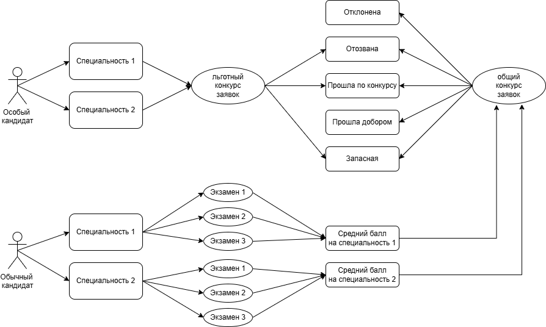
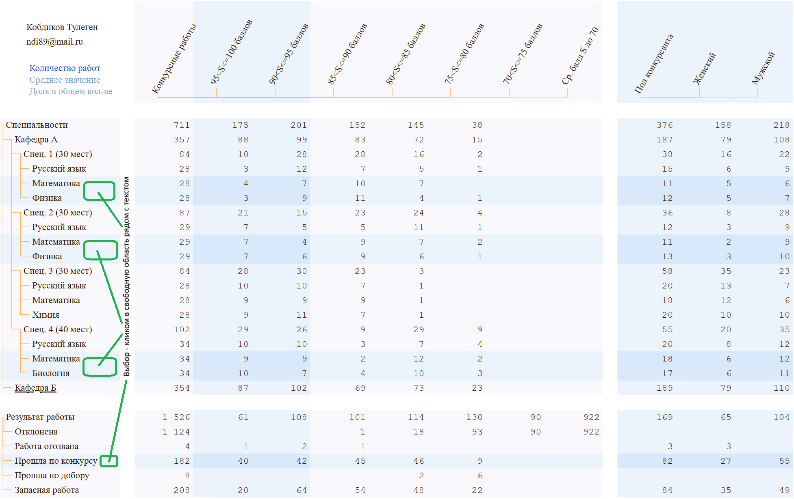

# Аналитика конкурса вступительных экзаменов

Для кандидата, участвующего в сдаче вступительных экзаменов, важно сохранять спокойствие и терпение на протяжнении всего конкурса, несмотря на давление со стороны конкурентов. Так как многие участники подают документы на несколько специальностей, то многие из них, даже с высокими баллами, выйдут из конкурса на свободные места, если участник пройдет на другую специальность. То же касается льготников, которые могут выбрать другую специальность, освободив место обычным участникам. Анализ вступительных конкурсов прошлых лет может воодушевить кандидата бороться до конца. 

Для педагога, по меньшей мере, важно отличать средний балл всех участников от среднего балла поступивших. Посчитать количество или долю участников с высоким уровнем оценок и т.д.

Потенциальных пользователей аналитики по экзаменам - тысячи студентов вместе с их родителями. Педагогов, методистов, проверяющих и других заинтересованных в аналитике в каждом вузе могут быть десятки-сотни. Для такой широкой аудитории нужен специальный инструмент, лицензионная политика которого не привязана к количеству рабочих мест.

Заявка кандидата на интересующую специальность по результатам конкурса может иметь следующие статусы:
1. Отклонена - когда участник не прошёл конкурс.
2. Отозвана - когда участник прошёл конкурс, но позже забрал свои документы.
3. Прошла по конкурсу - когда участник прошёл конкурс и зачислен на специальность.
4. Прошла добором - когда участник зачислен дополнительным набором на отозванные заявки.
5. Запасная - когда участник прошёл конкурс на другую специальность и все остальные его заявки стали запасными.

Управление на компьютере - мышкой, колесико мыши - вертикальная прокрутка, Shift + колесико мыши - горизонтальная прокрутка. Управление в сотовом телефоне - жестами.

Переходите к интерактивному демо: [Конкурс заявок (средних баллов)](https://kobdik.github.io/Cube/contest.html)

Аналитика экзаменационных работ: [Конкурс работ (экзаменов)](https://kobdik.github.io/Cube/exam.html)